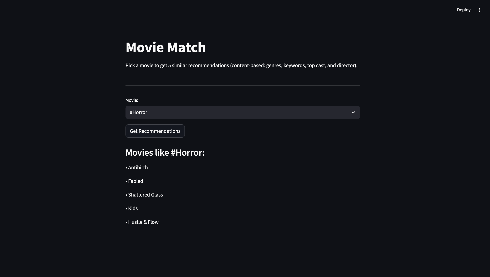

# Movie Match

A movie recommender I built using the TMDB 5000 dataset, plus a model that
tries to predict if a movie will do well at the box office. Basically
pretending to be a data scientist at a streaming company trying to figure
out what to recommend people and what to greenlight.



## What it does

### Recommender (content-based)
Takes each movie's genres, keywords, top 3 actors, and director and combines
them into one text field per movie. Runs TF-IDF on that, then cosine
similarity to see which movies are "closest" to each other. Type in a
movie, get back 5 similar ones.

### Hybrid version (content + collaborative filtering)
The problem with just content-based is it only looks at what a movie IS,
not what people actually watch. So two totally different movies could get
watched by the same people and the content model would never catch that.

Since this dataset doesn't have real user ratings, I simulated them: 500 users, each rating 20 movies (14 from two favorite genres, 6 random), with higher ratings for movies in their favorite genres. Then I trained an SVD model on those ratings with the surprise library.

I compared SVD against two baselines: random guessing (RMSE 1.204) and predicting from user and movie averages (RMSE 0.910). SVD scored 0.923, about the same as the averages baseline. That makes sense here: each simulated user only has about 16 training ratings, too few for SVD to learn more than their average taste. With real viewing history, collaborative filtering would have much more to learn from.

Then I combined both scores:
```
final_score = 0.5 * content_score + 0.5 * collaborative_score
```

The important part: same movie, different user, different
recommendations. That's the proof it's actually using the simulated user data
and not just falling back on content similarity every time.

### Box office classifier
Tried to predict if a movie would be a "hit" (made back 2x its budget)
using stuff you'd know before release — budget, runtime, release month,
genre.

First I removed movies with missing revenue (listed as $0) or obviously wrong budgets, leaving 3,216 movies.

First try got 70% accuracy, which seemed decent until I checked feature importance and saw “popularity” was doing over a third of the work. Problem is popularity on TMDB isn’t really a pre-release number, it can go up after a movie comes out and people start searching it, so using it was data leakage.

Took it out and reran it, and accuracy dropped to 54.5%. That’s actually below the 57% you’d get by always guessing “hit,” so budget, runtime, and month alone don’t predict success. You’d need better features (star power, sequel or not, marketing budget) to actually do this for real.

### The app
Streamlit app, pick a movie from a dropdown, click a button, get recs.
Nothing fancy but it works.

## Built with
Python, pandas, scikit-learn, surprise, Streamlit

## Running it

```bash
git clone https://github.com/brookelee8519/Movie-Match.git
cd Movie-Match
pip install -r requirements.txt
streamlit run app.py
```

Needs the TMDB 5000 Movie Dataset CSVs (movies + credits) in a `data/`
folder — grab them from Kaggle.

## Stuff that's not perfect / what I'd fix with more time

- the ratings are simulated, so the collaborative filtering part is more of a
  proof it works than something trained on real behavior
- popularity leaking into the classifier was a good reminder to actually
  check feature importance instead of just trusting the accuracy number
- only used first genre listed + top 3 cast for the tags, a real version
  would probably use more
- with actual user watch history this whole thing would be a lot more
  legit, especially the collaborative filtering side
